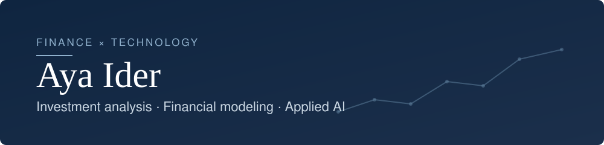

 

## About

I am a final-year Finance student at **ENCG Agadir** (Morocco), working at the intersection of **finance and technology**. I build tools that turn financial reasoning into working software: valuation and investment-appraisal models, risk-scoring logic, and data-driven applications.

My interests are **private equity, investment analysis, asset management, corporate finance and risk management**, with a focus on financial modeling, data analytics, automation and applied AI in finance.

 

## Featured Projects

### [GeoCapp](https://github.com/IDER04/GeoCapp)
**Country risk and investment analysis platform** · Python, Streamlit, Plotly, pandas

An application that links a country's history and financial indicators to a readable investment decision. Each country gets a 0–100 score built from five transparent components and a four-level verdict. Required return is computed as cost of equity with a country risk premium, following Damodaran's approach.

- 10-country MVP with an interactive map, country profiles and an 11-indicator dashboard
- Virtual portfolio simulation with weighted required return, volatility and diversification diagnostics
- Optional AI analyst (FR/EN): calculations stay deterministic in Python, and the model only explains validated facts
- Automated test suite covering scoring, data quality, localization and the AI layer

[View repository →](https://github.com/IDER04/GeoCapp)

### [Credit Risk Agent](https://github.com/IDER04/Credit-risk-agent)
**AI agent for banking credit-risk analysis** · Python, MySQL, LLM tool calling, Streamlit

An LLM agent that answers questions about a bank's loan portfolio, scores client risk and monitors portfolio exposure. The model never decides risk: scores come from deterministic rules in Python, and the agent only queries MySQL through a set of defined tools and explains the results.

- Portfolio summary, client comparison and highest-risk ranking
- Controlled database operations: every write is staged as a pending change and executes only after human confirmation
- Parameterized queries, input validation, and tests for tool safety and scoring rules
- Fictional sample data only

[View repository →](https://github.com/IDER04/Credit-risk-agent)

### [VAN Studio](https://github.com/IDER04/VAN-Studio)
**Corporate finance application for comparing investment projects** · Python, Streamlit, Plotly, pandas, NumPy

A dashboard that models two projects side by side and updates the analysis live as the discount rate, outlay, project life or cash flows change.

- NPV (VAN), IRR, profitability index and discounted payback
- Discount-rate sensitivity curve and crossover rate between the two projects
- Decision verdict, cumulative discounted cash flow charts and CSV export
- Unit-tested financial engine

[View repository →](https://github.com/IDER04/VAN-Studio)

 

## Technical Skills

**Programming & Data** 
Python · Pandas · OpenPyXL · SQL · MySQL

**Business Intelligence** 
Power BI · DAX · Power Query · KNIME

**Financial Analysis & Modeling** 
Financial Modeling · DCF Valuation · Investment Analysis · WACC · Scenario Analysis · Credit Risk Analysis

**Tools & Platforms** 
Advanced Excel · VBA · Git · Streamlit

 

## Areas of Interest

**Investment & Capital Markets** 
Private Equity · Investment Analysis · Asset Management

**Corporate Finance** 
Corporate Finance · Financial Modeling · Valuation

**Risk & Financial Technology** 
Risk Management · Financial Automation · AI Applications in Finance

 

## Contact

[LinkedIn](https://www.linkedin.com/in/aya-ider/) · [Email](mailto:aya.ider13@gmail.com) · [GitHub](https://github.com/IDER04)
